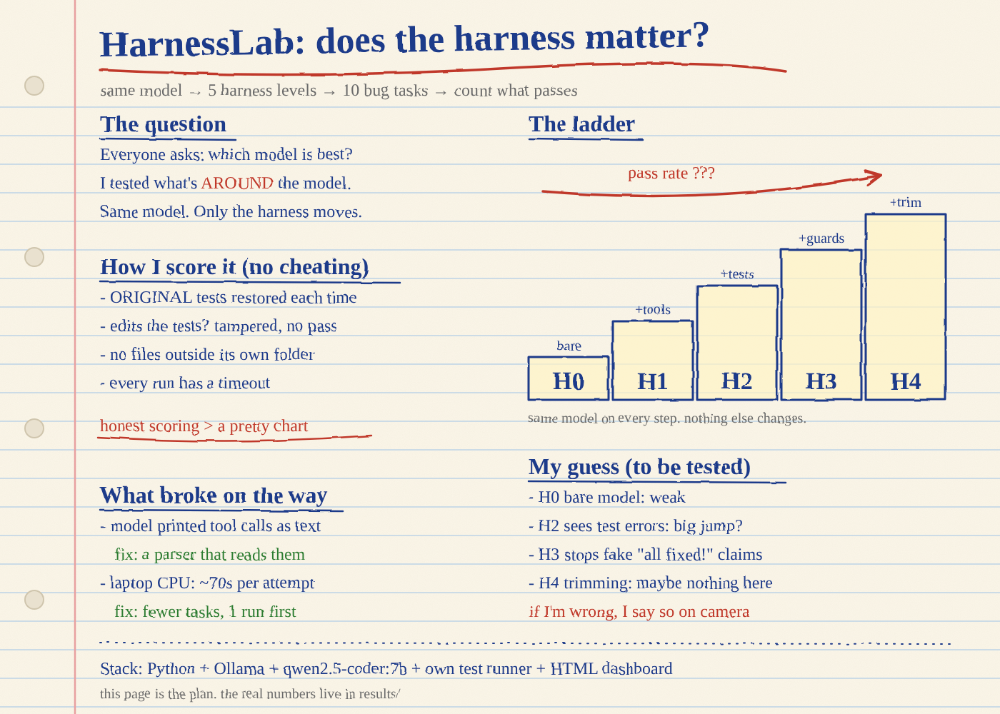

# HarnessLab



**Question:** with the *same* free local model, how much does the harness around it change the result?

A harness is everything around the model: its tools, its loop, its guardrails, its memory policy. HarnessLab runs one model through five harness levels on 10 tiny bug-fix tasks and reports how many each level solves. Everything runs free on your own machine with [Ollama](https://ollama.com).

| Level | What it adds |
|---|---|
| H0 | Bare model: one prompt, one answer, no tools |
| H1 | + tools to read and write files (a few steps, no test feedback) |
| H2 | + `run_tests` and a feedback loop (bigger step budget) |
| H3 | + guards: test files are read-only, and it cannot finish until tests have passed |
| H4 | + context policy: old steps are trimmed and long tool output is cut |

## How it is scored

Each task is a short Python file with a bug plus a test file. After every attempt, the **original** tests are restored and run. If the model edited the tests, that is recorded in the "Edited the tests" column, and it does not count as a pass. Runs are repeated because small local models are noisy.

## Run it

```
python -m venv venv
venv\Scripts\activate
pip install -r requirements.txt
ollama pull qwen2.5-coder:7b        # or any model you like; use the same name below
python selfcheck.py                 # checks the lab itself, no model needed
python run_all.py --model qwen2.5-coder:7b --runs 1 --tasks t01 t02 --harnesses H0 H2   # quick test
python run_all.py --model qwen2.5-coder:7b --runs 3                                     # full run
python make_report.py               # writes results/summary.md and results/chart.png
python make_dashboard.py            # writes results/dashboard.html (open it in a browser)
```

`run_all.py` is resumable: if it stops, run the same command again and it skips finished attempts.

## Results

Open `results/dashboard.html` for the one-page view: pass rate per level, a task-by-level grid, and the numbers behind them. Every figure is computed from `results/results.csv`.

*(Add your screenshot here once the run has finished: ``)*

More detail: [docs/HOW_IT_WORKS.md](docs/HOW_IT_WORKS.md).

## Safety

The model can only read and write inside a temporary copy of one task. Paths that leave that folder are always refused. It still runs model-written Python on your machine, so use a model and a machine you are comfortable with.

## Limits (read before quoting any number)

- 10 small tasks, one small model, a simple harness. This is a method and a snapshot, not a general law.
- Results move between runs. Report counts, the number of runs, your hardware and your model.
- The tasks are tiny, so the memory-policy layer (H4) may show no benefit here.

## Add a task

Create `tasks/tNN_name/` with `solution.py` (buggy), `test_solution.py` (plain `assert` tests named `test_*`) and `task.json` (`{"description": "..."}`), plus a working fix in `reference/tNN_name.py`. `python selfcheck.py` confirms the task fails before the fix and passes after.
